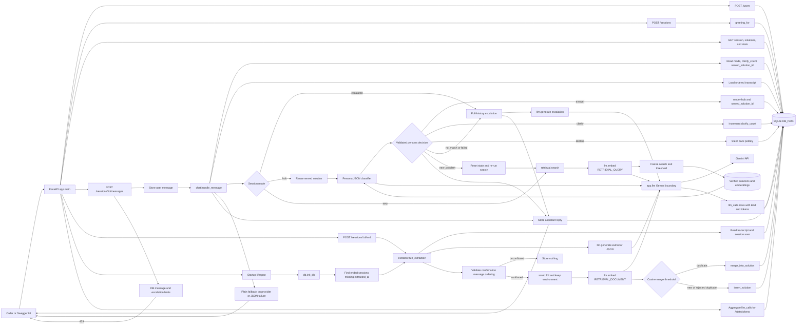

## Application overview

The architecture keeps persisted state and transcripts in SQLite. `app/main.py` owns HTTP routing and startup, `app/chat.py` owns the per-message state machine, `app/retrieval.py` performs embedding search, `app/llm.py` is the only provider boundary, and `app/extractor.py` adds only customer-confirmed fixes to the hub.

# Data model

- Six tables—`users`, `sessions`, `messages`, `solutions`, `solution_sources`, and `llm_calls`—separate identity, conversation state, verified knowledge, provenance, and provider usage.
- `solution_sources` links one solution to many sessions and the exact confirming message, enabling merged fixes to carry provenance and a meaningful `use_count`.
- Solutions contain only generalized symptoms, technical environment, fix steps, and failed attempts. Names, addresses, links, account identifiers, and order numbers are excluded, keeping customer identity outside the reusable hub.
- Embeddings are float32 bytes in SQLite `BLOB` columns. This is simple, restart-safe, and supports dot-product cosine search without an ORM or vector database.

# When the extractor runs and why

- Extraction runs synchronously when a session ends, because its transcript is complete and confirmation can be ordered after the fix suggestion.
- It handles multiple problems and fail-then-succeed flows. A failed attempt is not stored independently; it is recorded only alongside a later customer-confirmed fix.
- The extractor reads messages from SQLite, not memory. This makes retries deterministic across server restarts.
- If extraction crashes, `extracted_at` remains null. Startup sweeps ended sessions that are missing extraction, providing crash-safe retry behavior.

# How a reworded problem finds a solution and why

- The query joins all customer messages with ` | `, allowing a later device or OS clarification to refine the original problem.
- Gemini embeddings cover title plus symptoms. Cosine search over normalized solution vectors recalls paraphrases and broadly related wording.
- Recalled candidates are not accepted automatically. A persona LLM receives only those saved candidates and judges whether the customer and candidate share the same underlying fault, adding precision.
- Embeddings can confuse shared vocabulary, such as "sync stuck connecting" versus "sync created duplicate files." The same-fault judgment blocks that negative match.
- The retrieval threshold was tuned on a small set of paraphrases and negatives. If the environment is ambiguous, one clarification is allowed; after one, the system stops asking.

# How 'confirmed' is detected

- The extractor asks for the message ID of the customer's confirming statement and limits extraction to customer role messages.
- Code validates that the ID exists, belongs to `user`, and follows an earlier assistant message in the transcript.
- This establishes that the fix suggestion came first and a customer later described resolution.
- Assistant claims, uncertainty, "I'll try later," failures, silence, and malformed confirmations are rejected and never stored.

# What I'd build next with a week

- Add a labeled paraphrase/negative evaluation set and track precision, recall, clarification count, and escalation rate.
- Add reranking after broad retrieval to improve same-fault precision without weakening recall.
- Add success/failure feedback, confidence decay, and version-aware matching for stale fixes.
- Build a human review queue for low-confidence extraction and PII findings.
- Add authentication and ownership authorization instead of trusting caller-supplied user IDs.
- Add idle-session closure, streaming replies, and richer resume/summarization flows.
- Introduce a dedicated vector index when SQLite cosine scans no longer scale.
- Replace regex-only PII detection with a dedicated model or NER service, while preserving technical device and OS details.
