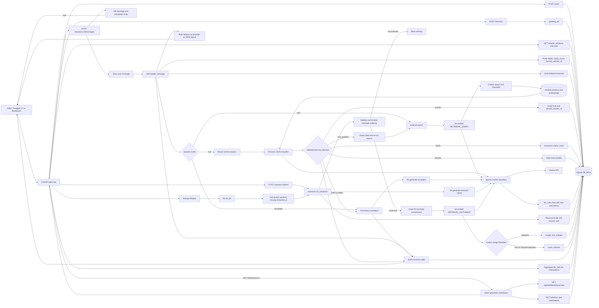

# Déjà Fix

Déjà Fix is a FastAPI and SQLite support chatbot that serves only customer-confirmed fixes from a knowledge hub, asks one short clarification when a match is ambiguous, and escalates to Gemini only when no verified answer is available. It also extracts generalized, scrubbed fixes when sessions end, merges duplicates, and keeps conversation state in SQLite so the server can restart safely.

## Prerequisites

- Python 3.11 or newer
- A Gemini API key
- Internet access for Gemini generation and embeddings

## Setup in five minutes

1. Clone the project and enter it:

   ```bash
   git clone <your-repository-url>
   cd deja-fix
   ```

2. Create and activate a virtual environment:

   ```bash
   python3 -m venv .venv
   source .venv/bin/activate
   ```

3. Install dependencies:

   ```bash
   pip install -r requirements.txt
   ```

4. Create `.env` and set the key:

   ```bash
   cp .env.example .env
   ```

   Open `.env` and replace `GEMINI_API_KEY=your-key-here` with your real key. Never commit `.env`.

5. Optionally confirm available model IDs:

   ```bash
   python scripts/list_models.py
   ```

   Set `GEMINI_MODEL` and `EMBED_MODEL` in `.env` if needed.

## Run the API

```bash
python -m uvicorn app.main:app --reload
```

Open the web dashboard at [http://127.0.0.1:8000/dashboard](http://127.0.0.1:8000/dashboard). `/` also opens the dashboard.

Open Swagger UI at [http://127.0.0.1:8000/docs](http://127.0.0.1:8000/docs). The dashboard provides live overview metrics, support chat, session browsing, knowledge-hub cards, and token usage charts without a separate frontend server.

## Run the demo

```bash
python scripts/demo.py
```

The demo uses `demo_dejafix.db`, starts and restarts the server, exercises the three-session scenario and bonus checks, and prints a PASS/FAIL report.

## Environment variables

| Variable | Default | Purpose |
|---|---:|---|
| `GEMINI_API_KEY` | none | Gemini API key; required for LLM calls |
| `GEMINI_MODEL` | `gemini-3.5-flash` | Generation model |
| `EMBED_MODEL` | `gemini-embedding-001` | Embedding model |
| `DB_PATH` | `dejafix.db` | SQLite database path |
| `MSG_LIMIT_PER_MIN` | `10` | Stored user-message limit per minute |
| `ESC_LIMIT_PER_HOUR` | `5` | Escalation limit per hour |
| `LLM_TIMEOUT_SECONDS` | `30` | Gemini request timeout |
| `RETRIEVAL_THRESHOLD` | `0.60` | Minimum cosine score for hub candidates |
| `MERGE_THRESHOLD` | `0.88` | Cosine score for automatic solution deduplication |

## API endpoints

| Method | Endpoint | Purpose |
|---|---|---|
| `GET` | `/health` | Health check |
| `POST` | `/users` | Create or find a user by name |
| `POST` | `/sessions` | Create a session and return its greeting |
| `GET` | `/users/{user_id}/sessions` | List a user's sessions |
| `GET` | `/sessions/{session_id}?user_id=N` | Read session and transcript |
| `POST` | `/sessions/{session_id}/messages` | Send a message and get the chat reply |
| `POST` | `/sessions/{session_id}/end` | End and extract from a session |
| `GET` | `/solutions` | Inspect generalized verified solutions |
| `GET` | `/stats/tokens` | Inspect token usage and hub/escalation totals |
| `GET` | `/dashboard` or `/` | Open the operations dashboard |
| `GET` | `/api/dashboard/overview` | Return known user IDs for dashboard navigation |

## Testing behaviors

- **Empty hub:** start a fresh database and send a problem; it should escalate and include the unverified-prefix only for the first escalation.
- **Confirmed extraction:** in `/docs`, end a session after a user clearly says that the fix worked; check `/solutions` for exactly the resolved issue.
- **PII safety:** inspect `/solutions`; names, emails, links, phone numbers, and order/account-style IDs must not appear.
- **Hub matching:** create a second session with reworded symptoms; answer the short clarification and verify `mode` is `hub` and `escalated` is `false`.
- **Negative match:** describe a distinct fault containing shared vocabulary; verify it escalates instead of reusing the wrong fix.
- **Restart:** stop and restart Uvicorn, then call `/solutions`; persisted solutions and sessions must remain available.
- **Rate limits:** send more than `MSG_LIMIT_PER_MIN` messages and inspect the `429` response plus `Retry-After` header.
- **Escalation limit:** exceed `ESC_LIMIT_PER_HOUR` escalation calls and inspect the escalation `429` response.
- **Token stats:** inspect `/stats/tokens` after hub and escalated sessions for per-session and average totals.
- **Dashboard:** open `/` or `/dashboard`; verify overview metrics, chat sessions, knowledge-hub cards, session statuses, and token totals update from SQLite/API data.

## Assumptions

- User IDs are trusted because this is a hackathon API without authentication.
- Unconfirmed fixes are never stored or served.
- Embedding token counts are estimated at characters divided by four because the embedding API may not report usage.
- Rate limits are configurable and counted from database timestamps.
- Retrieval thresholds are tuned on a small demo set and may need evaluation with more data.
- The extractor runs at session end and via a startup sweep for sessions whose extraction was missed.

## Project structure

```text
app/
  __init__.py
  config.py
  db.py
  llm.py
  scrub.py
  retrieval.py
  chat.py
  extractor.py
  main.py
  static/
    dashboard.html
scripts/
  smoke_test.py
  list_models.py
  demo.py
```

## Application overview



The architecture keeps persisted state and transcripts in SQLite. `app/main.py` owns HTTP routing and startup, `app/chat.py` owns the per-message state machine, `app/retrieval.py` performs embedding search, `app/llm.py` is the only provider boundary, and `app/extractor.py` adds only customer-confirmed fixes to the hub.